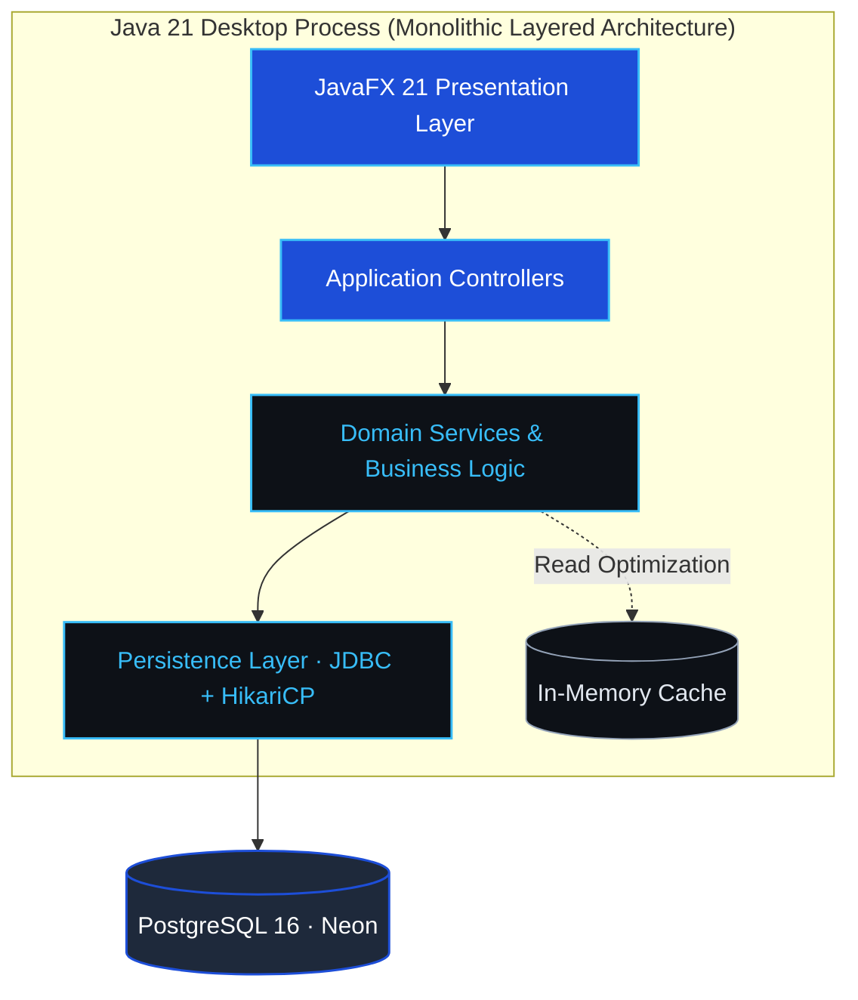

<!-- Profile README for https://github.com/Mateosalazar543 -->

<picture>
  <source media="(prefers-color-scheme: dark)" srcset="https://readme-typing-svg.demolab.com?font=Fira+Code&weight=600&size=16&duration=3200&pause=900&color=38BDF8&center=true&vCenter=true&width=540&height=36&lines=Backend+Systems+%C2%B7+Layered+Architecture+%C2%B7+Data+Integrity;CareStock%3A+Academic+Milestone+Completed+(Java+21);CORPUS%3A+Bilingual+Terminology+Search+System+(In+Progress);Bogot%C3%A1%2C+Colombia+%C2%B7+Pontificia+Universidad+Javeriana" />
  <source media="(prefers-color-scheme: light)" srcset="https://readme-typing-svg.demolab.com?font=Fira+Code&weight=600&size=16&duration=3200&pause=900&color=1D4ED8&center=true&vCenter=true&width=540&height=36&lines=Backend+Systems+%C2%B7+Layered+Architecture+%C2%B7+Data+Integrity;CareStock%3A+Academic+Milestone+Completed+(Java+21);CORPUS%3A+Bilingual+Terminology+Search+System+(In+Progress);Bogot%C3%A1%2C+Colombia+%C2%B7+Pontificia+Universidad+Javeriana" />
  
</picture>

 

 

<!-- Quick Navigation Bar -->

 

<picture>
  <source media="(prefers-color-scheme: dark)" srcset="https://capsule-render.vercel.app/api?type=rect&color=0:0D1117,50:1D4ED8,100:38BDF8&height=2" />
  <source media="(prefers-color-scheme: light)" srcset="https://capsule-render.vercel.app/api?type=rect&color=0:CBD5E1,50:1D4ED8,100:38BDF8&height=2" />
  
</picture>

## 🏛️ About Me

I am a **Systems Engineering student** at **Pontificia Universidad Javeriana** (Bogotá, Colombia), focused on **backend engineering, layered software architecture, relational data integrity, and CI/CD automation**.

In **November 2026**, my team and I completed the academic milestone for **CareStock**, a multi-pharmacy inventory desktop application built with **Java 21, JavaFX 21, and PostgreSQL 16**, where I contributed across system architecture, core implementation, automated testing, and containerized delivery. Currently, I am building **CORPUS**, a bilingual (`EN ↔ ES`) environmental terminology search system and browser lookup tool.

I integrate **AI as an engineering copilot** to accelerate prototyping and analysis while maintaining strict human code review, empirical verification, and full ownership of architectural decisions.

| Focus Area | Current Scope |
| :--- | :--- |
| **Completed Milestone** | **CareStock** — Multi-pharmacy inventory management, automated test suite, static analysis, and Docker delivery |
| **Active Development** | **CORPUS** — Bilingual (`EN ↔ ES`) environmental terminology search engine and browser assistant |
| **Published Artifacts** | CareStock Linux/amd64 container images (`v1.0.2` and `stable`) on Docker Hub |
| **Web Application** | **VerbQuest** — Responsive web platform for practicing English irregular verbs |
| **Next Technical Focus** | Spring Boot · RESTful API design · Cloud deployment and observability |
| **Core Stack** | Java 21, JavaFX, PostgreSQL, JDBC, JUnit 5, Mockito, GitHub Actions, Docker |

> [!NOTE]
> Reproducible builds, traceable schema changes, automated quality gates, and clear architectural boundaries matter more than shipping unverified code. Completing an academic milestone is a baseline; hardening software for production is a distinct engineering discipline.

 

<picture>
  <source media="(prefers-color-scheme: dark)" srcset="https://capsule-render.vercel.app/api?type=rect&color=0:0D1117,50:1D4ED8,100:38BDF8&height=2" />
  <source media="(prefers-color-scheme: light)" srcset="https://capsule-render.vercel.app/api?type=rect&color=0:CBD5E1,50:1D4ED8,100:38BDF8&height=2" />
  
</picture>

## ⚙️ Tech Stack

#### Languages
<picture>
  <source media="(prefers-color-scheme: dark)" srcset="https://skillicons.dev/icons?i=java,c,cpp,js,html,css&theme=dark&perline=6" />
  <source media="(prefers-color-scheme: light)" srcset="https://skillicons.dev/icons?i=java,c,cpp,js,html,css&theme=light&perline=6" />
  
</picture>

  

#### Backend & Data Persistence
<picture>
  <source media="(prefers-color-scheme: dark)" srcset="https://skillicons.dev/icons?i=postgres&theme=dark" />
  <source media="(prefers-color-scheme: light)" srcset="https://skillicons.dev/icons?i=postgres&theme=light" />
  
</picture>

 

 

#### Testing & Static Analysis

 

#### Build, CI/CD & Environments
<picture>
  <source media="(prefers-color-scheme: dark)" srcset="https://skillicons.dev/icons?i=maven,git,githubactions,docker,linux&theme=dark&perline=5" />
  <source media="(prefers-color-scheme: light)" srcset="https://skillicons.dev/icons?i=maven,git,githubactions,docker,linux&theme=light&perline=5" />
  
</picture>

 

<picture>
  <source media="(prefers-color-scheme: dark)" srcset="https://capsule-render.vercel.app/api?type=rect&color=0:0D1117,50:1D4ED8,100:38BDF8&height=2" />
  <source media="(prefers-color-scheme: light)" srcset="https://capsule-render.vercel.app/api?type=rect&color=0:CBD5E1,50:1D4ED8,100:38BDF8&height=2" />
  
</picture>

## 📦 Featured Projects

<!-- CARD 1: CareStock -->
<table width="100%">
  <tr>
    <td>
      <h3><a href="https://github.com/puj-course/FIS_2630_1204_G1">CareStock</a> &mdash; Multi-Pharmacy Inventory &amp; Traceability System</h3>
      

        
        
        
        
        
      

      

        Team-engineered desktop application designed for multi-pharmacy inventory control, featuring <strong>tenant-scoped data segregation</strong>, role-based access sessions, and lot-level traceability across medicines, hygiene, and maternity product lines.
      

      <ul>
        <li><strong>Domain &amp; Workflows:</strong> Product catalog management, batch/lot tracking, stock movements, threshold alerts, and replenishment operations.</li>
        <li><strong>Software Architecture:</strong> Layered MVC-oriented JavaFX structure implementing <em>Factory Method, Facade, Proxy,</em> and <em>Template Method</em> patterns, documented with C4 and UML diagrams.</li>
        <li><strong>Data &amp; Security:</strong> PostgreSQL 16 (Neon) accessed via JDBC with HikariCP connection pooling, BCrypt password hashing, and pharmacy-isolated queries.</li>
        <li><strong>Verification &amp; Quality Gates:</strong> JUnit 5, Mockito, Maven Surefire, and JaCoCo (over 1,200 test executions in final local verification), paired with SonarCloud analysis, pre-PR coverage checks, and a custom Java AST analyzer measuring LOC, cyclomatic complexity, and nesting depth.</li>
        <li><strong>CI/CD &amp; Packaging:</strong> Automated GitHub Actions pipelines for builds, isolated PostgreSQL 16 SQL integration tests, Docker image validation (Linux/amd64), and Telegram build notifications.</li>
        <li><strong>Current Scope &amp; Disclaimer:</strong> Academic milestone completed in <strong>November 2026</strong>. Native Windows installer packaging remains to be validated; this system is an academic artifact and is <strong>not certified for clinical or production healthcare use</strong>.</li>
      </ul>
      

        
        
      

    </td>
  </tr>
</table>

<b>📐 CareStock Layered Architecture Diagram</b> (click to expand)

 

> [!TIP]
> **Architectural Boundary:** Presentation, controllers, business rules, and JDBC persistence execute within a single Java desktop process, while PostgreSQL 16 operates as an external relational store. CareStock is a standalone desktop client, not a decoupled REST microservice.

 

<!-- CARD 2: CORPUS -->
<table width="100%">
  <tr>
    <td>
      <h3><a href="https://github.com/Mateosalazar543/CORPUS">CORPUS</a> &mdash; Bilingual Environmental Terminology Search System (EN &harr; ES)</h3>
      

        
        
        
      

      

        Client-oriented terminology search platform and browser-assisted lookup tool designed to index parallel English&ndash;Spanish environmental literature with source traceability (DOIs and institutional references).
      

      <ul>
        <li><strong>Sprint 1 Focus:</strong> Corpus data standardization, relational schema design for term-to-context normalization, and automated ingestion pipelines.</li>
        <li><strong>Planned Capabilities:</strong> Predictive bilingual concordance search, thematic domain filtering, side-panel browser lookup, and curated term proposals.</li>
      </ul>
      <!-- TODO: Add final backend/frontend stack badges, architecture diagram, and live deployment link once Sprint 1–4 milestones are completed -->
      

        
      

    </td>
  </tr>
</table>

 

<!-- CARD 3: VerbQuest -->
<table width="100%">
  <tr>
    <td>
      <h3><a href="https://github.com/Mateosalazar543/VerbQuest">VerbQuest</a> &mdash; Interactive English Verb Training Web App</h3>
      

        
        
        
        
      

      

        Browser-based educational application built to reinforce English irregular verb conjugation through structured, progressive practice modules.
      

      <ul>
        <li><strong>Key Features:</strong> Adaptive difficulty progression, immediate feedback loops, and a mobile-first responsive interface.</li>
      </ul>
      <!-- TODO: Add live demo URL badge for VerbQuest if you want to link the deployed Render instance directly -->
      

        
      

    </td>
  </tr>
</table>

 

<picture>
  <source media="(prefers-color-scheme: dark)" srcset="https://capsule-render.vercel.app/api?type=rect&color=0:0D1117,50:1D4ED8,100:38BDF8&height=2" />
  <source media="(prefers-color-scheme: light)" srcset="https://capsule-render.vercel.app/api?type=rect&color=0:CBD5E1,50:1D4ED8,100:38BDF8&height=2" />
  
</picture>

## 🧩 Engineering Principles

| Principle | Practical Application |
| :--- | :--- |
| **Maintainable Code** | Explicit naming, cohesive single-responsibility units, and predictable control flow. |
| **Purposeful Architecture** | Design patterns applied strictly to decouple responsibilities and solve structural problems. |
| **Data Integrity** | Normalized relational schemas, explicit constraints, connection pooling, and transactional safety. |
| **Evidence-Based Testing** | Automated unit and integration suites, coverage thresholds, and reproducible CI verification. |
| **Continuous Quality Gates** | Static code analysis, complexity metrics, and automated checks prior to branch integration. |
| **Accountable AI Usage** | Leveraging AI tools for speed while auditing every generated line, edge case, and dependency. |

 

<picture>
  <source media="(prefers-color-scheme: dark)" srcset="https://capsule-render.vercel.app/api?type=rect&color=0:0D1117,50:1D4ED8,100:38BDF8&height=2" />
  <source media="(prefers-color-scheme: light)" srcset="https://capsule-render.vercel.app/api?type=rect&color=0:CBD5E1,50:1D4ED8,100:38BDF8&height=2" />
  
</picture>

## 📊 GitHub Metrics

<picture>
  <source media="(prefers-color-scheme: dark)" srcset="https://github-readme-stats.vercel.app/api?username=Mateosalazar543&show_icons=true&bg_color=0D1117&title_color=38BDF8&icon_color=38BDF8&text_color=E2E8F0&border_color=1D4ED8&border_radius=10&include_all_commits=true" />
  <source media="(prefers-color-scheme: light)" srcset="https://github-readme-stats.vercel.app/api?username=Mateosalazar543&show_icons=true&bg_color=FFFFFF&title_color=1D4ED8&icon_color=1D4ED8&text_color=1E293B&border_color=CBD5E1&border_radius=10&include_all_commits=true" />
  
</picture>
<picture>
  <source media="(prefers-color-scheme: dark)" srcset="https://github-readme-stats.vercel.app/api/top-langs/?username=Mateosalazar543&layout=compact&bg_color=0D1117&title_color=38BDF8&text_color=E2E8F0&border_color=1D4ED8&border_radius=10" />
  <source media="(prefers-color-scheme: light)" srcset="https://github-readme-stats.vercel.app/api/top-langs/?username=Mateosalazar543&layout=compact&bg_color=FFFFFF&title_color=1D4ED8&text_color=1E293B&border_color=CBD5E1&border_radius=10" />
  
</picture>

 

<picture>
  <source media="(prefers-color-scheme: dark)" srcset="https://streak-stats.demolab.com?user=Mateosalazar543&background=0D1117&ring=1D4ED8&fire=38BDF8&currStreakNum=FFFFFF&sideNums=FFFFFF&currStreakLabel=38BDF8&sideLabels=94A3B8&dates=94A3B8&border=1D4ED8&border_radius=10" />
  <source media="(prefers-color-scheme: light)" srcset="https://streak-stats.demolab.com?user=Mateosalazar543&background=FFFFFF&ring=1D4ED8&fire=38BDF8&currStreakNum=0D1117&sideNums=0D1117&currStreakLabel=1D4ED8&sideLabels=475569&dates=475569&border=CBD5E1&border_radius=10" />
  
</picture>

 

<picture>
  <source media="(prefers-color-scheme: dark)" srcset="https://capsule-render.vercel.app/api?type=rect&color=0:0D1117,50:1D4ED8,100:38BDF8&height=2" />
  <source media="(prefers-color-scheme: light)" srcset="https://capsule-render.vercel.app/api?type=rect&color=0:CBD5E1,50:1D4ED8,100:38BDF8&height=2" />
  
</picture>

## 🗺️ Roadmap

| Status | Milestone |
| :---: | :--- |
|  | Design, build, and ship **VerbQuest** |
|  | Implement layered architecture, GoF patterns, and JDBC persistence in **CareStock** |
|  | Complete the **CareStock** academic milestone with CI pipelines, static analysis, and technical documentation |
|  | Containerize CareStock and publish versioned images (`v1.0.2`, `stable`) to **Docker Hub** |
|  | Deliver **CORPUS** across weekly Scrum sprints (data ingestion, search portal, and browser extension) |
|  | Complete validation of the native Windows installer workflow for CareStock |
|  | Build backend services with **Spring Boot** and RESTful API standards |
|  | Deepen cloud deployment and production observability practices |
|  | Contribute to open-source tooling |

 

<picture>
  <source media="(prefers-color-scheme: dark)" srcset="https://capsule-render.vercel.app/api?type=rect&color=0:0D1117,50:1D4ED8,100:38BDF8&height=2" />
  <source media="(prefers-color-scheme: light)" srcset="https://capsule-render.vercel.app/api?type=rect&color=0:CBD5E1,50:1D4ED8,100:38BDF8&height=2" />
  
</picture>

## 📫 Connect

<!-- TODO: Uncomment and complete when ready to publish professional contact links:

-->

  

