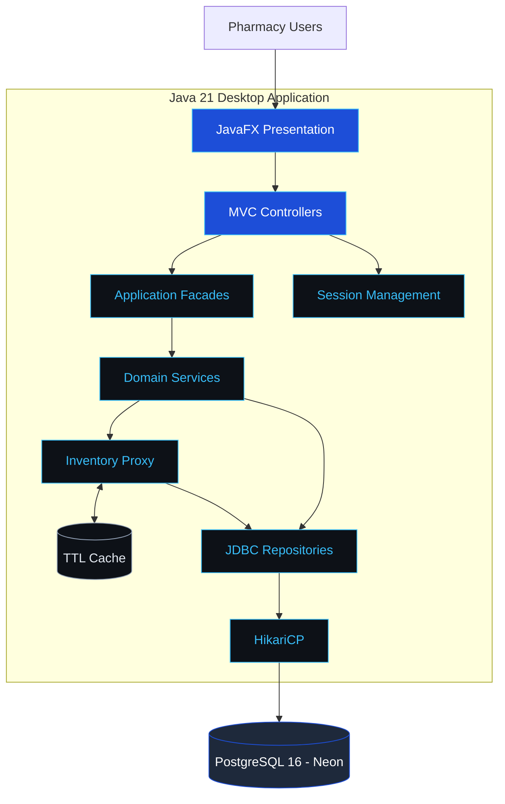
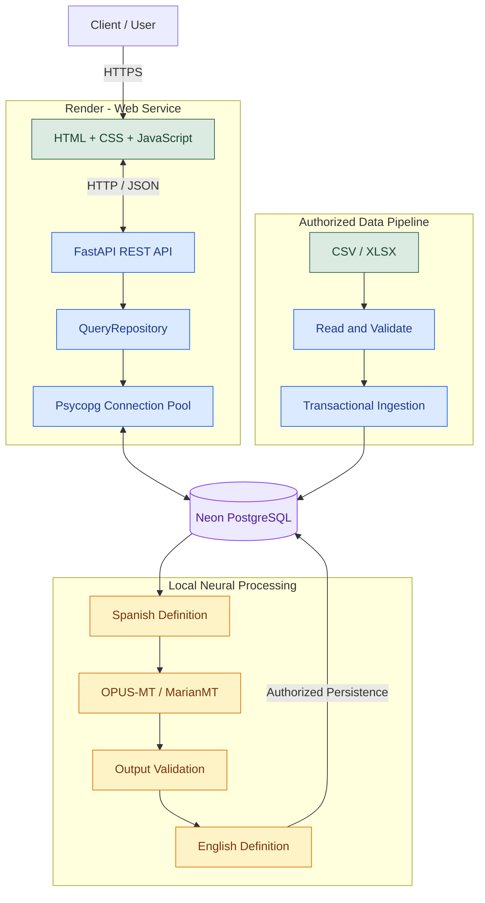
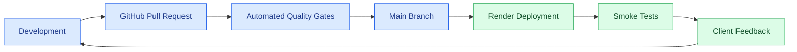
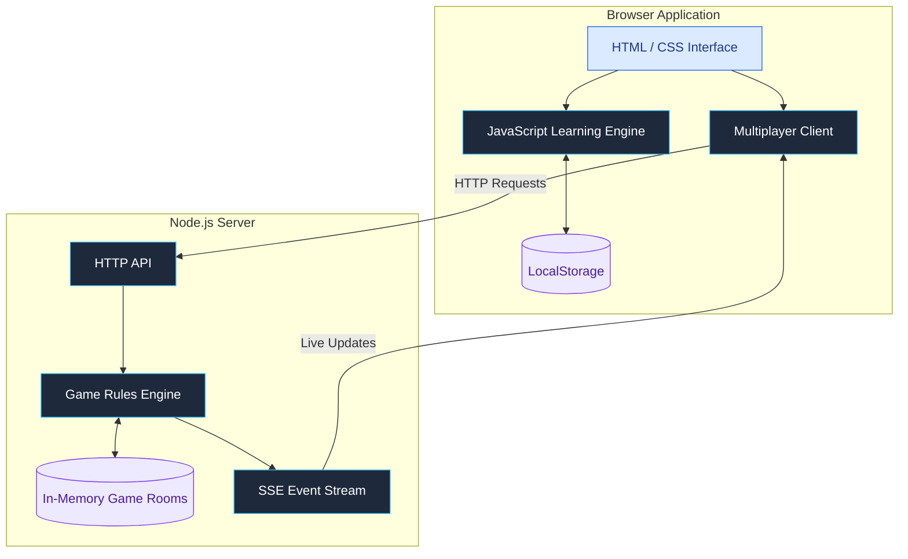
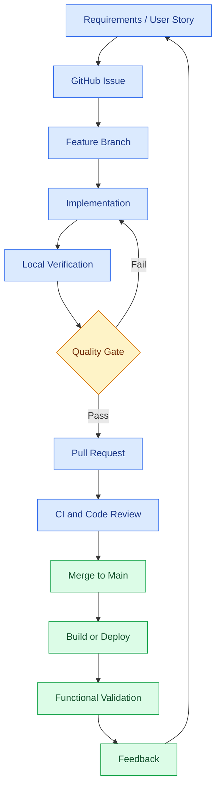

<!-- GitHub Profile README — Mateo Salazar Bogota -->

### Systems Engineering Student | Backend Engineering | Software Architecture

**Building reliable software through architecture, automation, and continuous improvement.**

<picture>
  <source media="(prefers-color-scheme: dark)" srcset="https://readme-typing-svg.demolab.com?font=Fira+Code&weight=600&size=15&duration=3200&pause=900&color=38BDF8&center=true&vCenter=true&width=600&height=40&lines=Backend+Engineering+%7C+Software+Architecture;Java+%7C+Python+%7C+PostgreSQL;Automated+Testing+%7C+CI%2FCD+%7C+Cloud;CareStock+%7C+CORPUS+%7C+VerbQuest;Pontificia+Universidad+Javeriana" />
  <source media="(prefers-color-scheme: light)" srcset="https://readme-typing-svg.demolab.com?font=Fira+Code&weight=600&size=15&duration=3200&pause=900&color=1D4ED8&center=true&vCenter=true&width=600&height=40&lines=Backend+Engineering+%7C+Software+Architecture;Java+%7C+Python+%7C+PostgreSQL;Automated+Testing+%7C+CI%2FCD+%7C+Cloud;CareStock+%7C+CORPUS+%7C+VerbQuest;Pontificia+Universidad+Javeriana" />
  
</picture>

 

 

 

## 🏛️ About Me

I am a **Systems Engineering student at Pontificia Universidad Javeriana**, based in Bogotá, Colombia, focused on backend engineering, software architecture, relational data integrity, automated testing, and cloud deployment.

My engineering interests revolve around designing software that is not only functional but also maintainable, secure, testable, and capable of evolving alongside its requirements.

I enjoy transforming complex problems into structured software solutions through architectural reasoning, modular implementation, and evidence-based technical decisions.

In November 2026, my team and I completed the academic milestone for **CareStock**, a multi-pharmacy inventory management system built with Java 21, JavaFX, and PostgreSQL.

I am currently developing **CORPUS**, a client-oriented bilingual environmental terminology platform whose first functional web prototype was deployed to the cloud and delivered to the client on November 26, 2026.

I also developed **VerbQuest**, an educational web application combining adaptive learning, gamification, and real-time multiplayer competitions.

I integrate artificial intelligence as an engineering copilot to accelerate prototyping, research, documentation, and technical analysis while maintaining human review, empirical verification, and ownership of architectural decisions.

### Current Focus

| Area | Current Scope |
| :--- | :--- |
| Backend Engineering | Java, Python, FastAPI, Node.js and RESTful services |
| Software Architecture | Layered architecture, MVC, GoF patterns and modular design |
| Data Engineering | PostgreSQL, relational modeling, migrations and automated ingestion |
| Software Quality | Automated testing, coverage, complexity and static analysis |
| Application Security | Input validation, dependency auditing and least privilege |
| Cloud Engineering | Render, Neon PostgreSQL, Docker and deployment automation |
| Applied NLP | Neural machine translation and persistent bilingual definitions |
| Distributed Systems | Concurrency, client-server communication and real-time events |
| Active Project | CORPUS — Bilingual environmental terminology platform |
| Completed Milestone | CareStock — Multi-pharmacy inventory system |
| Educational Project | VerbQuest — Adaptive English learning platform |

> [!NOTE]
> Reproducible builds, traceable schema changes, automated quality gates, and clear architectural boundaries matter more than shipping unverified code.
>
> Completing an academic milestone is a baseline. Hardening software for production is a distinct engineering discipline.

 

## ⚙️ Tech Stack

### Programming Languages

<picture>
  <source media="(prefers-color-scheme: dark)" srcset="https://skillicons.dev/icons?i=java,python,c,cpp,js,html,css&theme=dark&perline=7" />
  <source media="(prefers-color-scheme: light)" srcset="https://skillicons.dev/icons?i=java,python,c,cpp,js,html,css&theme=light&perline=7" />
  
</picture>

  

### Backend & Application Development

<picture>
  <source media="(prefers-color-scheme: dark)" srcset="https://skillicons.dev/icons?i=fastapi,nodejs,java&theme=dark&perline=3" />
  <source media="(prefers-color-scheme: light)" srcset="https://skillicons.dev/icons?i=fastapi,nodejs,java&theme=light&perline=3" />
  
</picture>

 

 

### Databases & Data Engineering

<picture>
  <source media="(prefers-color-scheme: dark)" srcset="https://skillicons.dev/icons?i=postgres&theme=dark" />
  <source media="(prefers-color-scheme: light)" srcset="https://skillicons.dev/icons?i=postgres&theme=light" />
  
</picture>

 

 

### Applied AI & Natural Language Processing

<picture>
  <source media="(prefers-color-scheme: dark)" srcset="https://skillicons.dev/icons?i=pytorch,python&theme=dark" />
  <source media="(prefers-color-scheme: light)" srcset="https://skillicons.dev/icons?i=pytorch,python&theme=light" />
  
</picture>

 

 

### Testing & Software Quality

 

### DevOps, Cloud & Infrastructure

<picture>
  <source media="(prefers-color-scheme: dark)" srcset="https://skillicons.dev/icons?i=git,github,githubactions,docker,maven,linux,bash&theme=dark&perline=7" />
  <source media="(prefers-color-scheme: light)" srcset="https://skillicons.dev/icons?i=git,github,githubactions,docker,maven,linux,bash&theme=light&perline=7" />
  
</picture>

 

 

### Architecture & Technical Documentation

 

## 📦 Featured Projects

<table>
  <tr>
    <td align="center" width="33%">
      
        
      <strong>CareStock</strong>
       
      Inventory Management
        
      
    </td>
    <td align="center" width="33%">
      
        
      <strong>CORPUS</strong>
       
      Bilingual Terminology Platform
        
      
    </td>
    <td align="center" width="33%">
      
        
      <strong>VerbQuest</strong>
       
      Educational Gaming
        
      
    </td>
  </tr>
</table>

 

<!-- PROJECT 01 — CARESTOCK -->

<table width="100%">
  <tr>
    <td width="125" align="center">
      
    </td>
    <td>
      <h2>CareStock</h2>
      <strong>Multi-Pharmacy Inventory &amp; Traceability System</strong>
       
      Software Architecture · Relational Data · Desktop Engineering
        
      
      
      
      
      
    </td>
  </tr>
</table>

CareStock is a team-engineered desktop application designed to manage inventory across multiple pharmacies, providing tenant-scoped data segregation, role-based access, product catalog management, and lot-level traceability.

The system was developed as an academic software engineering project with an emphasis on architectural consistency, automated quality assurance, and reproducible delivery.

### Core Capabilities

- Multi-pharmacy inventory management.
- Pharmacy-scoped data segregation.
- Role-based authentication and authorization.
- Active and inactive user management.
- Session lifecycle management and inactivity timeout.
- BCrypt password hashing.
- Product catalog management.
- Batch and lot traceability.
- Stock entry and withdrawal validation.
- Inventory movements.
- Pharmacy-specific indicators.
- Unified CRUD operations.
- Secure logout and session cleanup.

### Software Architecture

CareStock follows a layered MVC-oriented architecture within a standalone Java desktop process.

Design patterns applied throughout the system include:

| Pattern | Responsibility |
| :--- | :--- |
| MVC | Separation of presentation, application control and domain logic |
| Facade | Simplified access to complex inventory operations |
| Proxy | Controlled and cached inventory queries |
| Builder | Structured construction of domain objects |
| Singleton | Controlled session lifecycle and shared session state |

### Technical Highlights

- Java 21 and JavaFX 21.
- PostgreSQL 16 hosted through Neon.
- JDBC persistence with HikariCP connection pooling.
- Transactional inventory operations.
- Cached inventory queries with configurable TTL.
- Tenant-scoped query boundaries.
- UML class diagrams and C4 architecture documentation.
- Automated testing with JUnit 5 and Mockito.
- Coverage reports generated with JaCoCo.
- Static analysis and custom Java AST metrics.
- GitHub Actions quality pipelines.
- Isolated PostgreSQL integration tests.
- Docker container validation.
- Telegram build notifications.

### Delivery & Artifacts

 

<b>📐 View CareStock Architecture</b>

 

CareStock is a standalone layered desktop application, not a REST microservice architecture. The presentation, controllers, domain logic, and JDBC persistence run within the Java application process, while PostgreSQL operates as an external relational database.

<b>🧪 Verification & Engineering Results</b>

 

| Metric | Reference |
| :--- | :--- |
| Final local test executions | Over 1,200 reported |
| Testing framework | JUnit 5 and Mockito |
| Coverage tool | JaCoCo |
| Static analysis | SonarCloud |
| Architecture documentation | UML and C4 |
| Complexity analysis | Custom Java AST analyzer |
| Container registry | Docker Hub |
| Published image tags | `v1.0.2`, `stable` |
| Academic milestone | November 2026 |

Test counts represent historical local verification runs and may differ across commits or environments.

> [!IMPORTANT]
> CareStock is an academic software engineering artifact. It is not certified for clinical or production healthcare use. Native Windows installer validation remains a separate pending activity.

 

---

<!-- PROJECT 02 — CORPUS -->

<table width="100%">
  <tr>
    <td width="125" align="center">
      
    </td>
    <td>
      <h2>CORPUS</h2>
      <strong>Bilingual Environmental Terminology Platform</strong>
       
      Backend Engineering · Cloud Infrastructure · Applied NLP
        
      
      
      
      
      
    </td>
  </tr>
</table>

CORPUS is a client-oriented bilingual terminology platform focused on environmental sciences, designed to centralize English and Spanish terminology, conceptual definitions, linguistic variants, bilingual contexts, and documentary sources.

The platform integrates automated data ingestion, relational persistence, a responsive web portal, and neural machine translation.

Its first functional cloud prototype was deployed and delivered to the client on **November 26, 2026**.

### Live Prototype

  

> [!NOTE]
> The prototype initially uses Render's free hosting tier. A cold start may increase response times after inactivity. The health endpoint checks the web service, not the complete database dependency chain.

### Core Capabilities

- Bilingual terminology search (EN ↔ ES).
- English-to-Spanish and Spanish-to-English lookup.
- Thematic domain filtering.
- Real-time autocomplete.
- Terminological variants.
- Conceptual definitions.
- Documentary source traceability.
- DOI and URL references.
- Dynamic corpus statistics.
- Automated CSV and XLSX ingestion.
- Relational data normalization.
- Duplicate detection.
- Transactional persistence.
- Responsive web interface.
- Light and dark themes.
- Search First interface organization.
- REST API with OpenAPI documentation.

### Applied Natural Language Processing

CORPUS integrates the Helsinki-NLP OPUS-MT Spanish-to-English neural translation model based on MarianMT.

The translation architecture includes:

- Local CPU-based neural inference.
- Batched translation.
- LRU caching.
- Concurrent access control.
- Duplicate translation avoidance.
- Configurable model warmup.
- Basic translation output quality checks.
- Persistent English definitions.
- Traceability of automatically generated definitions.

The persistent translation increment is designed to eliminate mandatory neural inference from ordinary cloud search requests.

Instead of loading the model for every definition lookup, translations can be generated in an authorized local environment, stored in PostgreSQL, and retrieved by the deployed application.

This architecture is particularly useful for resource-constrained hosting environments.

Machine-generated definitions remain subject to specialized linguistic and scientific review.

### Web Engineering

| Component | Implementation |
| :--- | :--- |
| Backend | Python 3.12 and FastAPI |
| Frontend | HTML5, CSS3 and vanilla JavaScript |
| Template engine | Jinja2 |
| API contracts | Pydantic |
| Web server | Uvicorn |
| Database | Neon PostgreSQL |
| Database driver | Psycopg 3 |
| Data ingestion | CSV UTF-8 and Openpyxl |
| Neural translation | OPUS-MT, PyTorch and Transformers |
| Cloud deployment | Render |
| API documentation | OpenAPI, Swagger UI and ReDoc |
| Web app compatibility | Application icons and manifest foundations |

### Initial Corpus Snapshot

The following metrics represent the initial deployment dataset, rather than live counters:

The latest available corpus statistics can be retrieved from:

https://corpus-he6a.onrender.com/api/v1/stats

### Quality Engineering

| Metric | Verified Quality Baseline |
| :--- | ---: |
| Automated tests passed | 234 |
| Failed tests | 0 |
| Statement coverage | 100% |
| Branch coverage | 100% |
| Statements covered | 774 / 774 |
| Branches covered | 188 / 188 |
| Average cyclomatic complexity | 3.01 |
| Maximum cyclomatic complexity | 10 |
| Maintainability classification | A |
| Bandit findings | 0 |
| pip-audit findings | 0 |
| Mypy errors | 0 |
| Ruff findings | 0 |

The metrics above correspond to the verified refactoring baseline before the latest translation and PWA increments.

The expanded suite contains 267 test cases. Final regression results for that increment are pending documentation.

These historical results do not constitute a permanent guarantee of correctness or security.

### Cloud Infrastructure

- Private GitHub repository.
- Render Web Service.
- Neon serverless PostgreSQL.
- Environment-based configuration.
- GitHub Actions integration.
- Incremental delivery workflow.
- HTTPS deployment.
- Database connection pooling.
- Resource-conscious deployment strategy.
- Local neural processing with persistent results.

### Incremental Delivery

| Increment | Scope |
| :--- | :--- |
| `v0.1.0-alpha.1` | Initial functional cloud prototype |
| `v0.1.0-alpha.2` | Responsive optimization and Search First improvements |
| `v0.1.0-alpha.3` | Persistent English definitions, web app icons and PWA foundations |

These identifiers represent the proposed versioning of the development increments. Formal release tags and deployment verification must be confirmed separately.

<b>📐 View CORPUS Architecture</b>

 

The persistent translation architecture separates resource-intensive NLP operations from cloud-based terminology queries.

<b>☁️ View CORPUS Delivery Pipeline</b>

 

The diagram describes the intended incremental delivery workflow. Deployment conditions and automated release verification remain subject to configuration.

### Future Development

- Complete terminological entry pages.
- Aligned bilingual contexts.
- Concordance search.
- Advanced ranking and similarity search.
- Accent-insensitive queries.
- Curated terminology proposals.
- Browser-assisted lookup.
- Specialized translation glossary.
- Human linguistic validation.
- Accessibility testing.
- Production observability.
- Progressive Web App capabilities.
- Formal performance and load testing.

> [!IMPORTANT]
> CORPUS is under active development and client validation. Access to the source repository and redistribution of corpus data are subject to authorization. The prototype is not a certified terminological authority, and automatic translations require specialized review.

 

---

<!-- PROJECT 03 — VERBQUEST -->

<table width="100%">
  <tr>
    <td width="125" align="center">
      
    </td>
    <td>
      <h2>VerbQuest</h2>
      <strong>Adaptive English Learning &amp; Multiplayer Web Application</strong>
       
      Web Engineering · Educational Technology · Real-Time Communication
        
      
      
      
      
    </td>
  </tr>
</table>

VerbQuest is an interactive educational web application designed to reinforce English irregular verb conjugation through gamification, adaptive difficulty, immediate feedback, and real-time multiplayer competitions.

The application combines an independent learning engine with a lightweight Node.js multiplayer backend.

### Individual Learning

- Training bank of 80 irregular verbs.
- Base form, simple past and past participle exercises.
- Mixed practice modes.
- Adaptive question difficulty.
- Five difficulty levels.
- Progress tracking.
- Immediate answer feedback.
- Score and streak tracking.
- Error review sessions.
- Browser-based progress persistence.
- Responsive mobile-first interface.

### Multiplayer Competitions

- Private game rooms.
- Room access codes.
- Invitation links.
- Configurable competition duration.
- Configurable participant capacity.
- Real-time score updates.
- Live rankings.
- Server-side answer validation.
- Server-side scoring.
- Server-controlled competition timing.
- Winner determination.
- Session recovery within the supported game lifecycle.

### Technical Architecture

| Component | Technology |
| :--- | :--- |
| Frontend | HTML5, CSS3 and vanilla JavaScript |
| Backend | Node.js 20+ |
| HTTP communication | REST-style requests and Fetch API |
| Real-time communication | Server-Sent Events |
| Learning engine | Adaptive question generation |
| Individual persistence | LocalStorage |
| Multiplayer session recovery | SessionStorage |
| Multiplayer state | Server memory |
| Automated testing | Node.js test runner |
| Deployment target | Render |

The application uses native Node.js modules without requiring external npm dependencies for its current architecture.

### Educational Focus

VerbQuest is designed to transform repetitive language practice into a structured learning experience.

Its adaptive engine prioritizes areas that require reinforcement and adjusts the challenge according to student performance.

<b>📐 View VerbQuest Architecture</b>

 

Individual learning progress is stored locally in the browser. Multiplayer rooms and live competition state are maintained in server memory and may be lost when the process restarts.

 

## 🧪 Software Quality

Software quality is a core part of my engineering workflow rather than a final development activity.

I aim to incorporate measurable quality controls throughout implementation, refactoring, integration, and deployment.

### Quality Framework

| Dimension | Metrics & Practices |
| :--- | :--- |
| Functional Correctness | Automated tests, assertions and regression testing |
| Statement Coverage | Executable statements exercised by tests |
| Branch Coverage | Conditional execution paths exercised by tests |
| Cyclomatic Complexity | Independent control-flow paths |
| Nesting Depth | Structural complexity of conditional and iterative blocks |
| Lines of Code | Function and class size analysis |
| Maintainability | Maintainability index and static analysis |
| Security | Source scanning, dependency auditing and input validation |
| Reliability | Failure scenarios and controlled exception handling |
| Data Integrity | Constraints, foreign keys, transactions and integration tests |
| Reproducibility | Versioned configuration and automated build pipelines |
| Traceability | Issues, commits, pull requests and technical documentation |

### Project Quality Highlights

<table>
  <tr>
    <td align="center">
      
      <h3>CareStock</h3>
      <strong>1,200+</strong>
       
      Reported local test executions
        
      
      
    </td>
    <td align="center">
      
      <h3>CORPUS</h3>
      <strong>100%</strong>
       
      Verified baseline line and branch coverage
        
      
      
    </td>
    <td align="center">
      
      <h3>VerbQuest</h3>
      <strong>Automated</strong>
       
      Learning engine and HTTP/SSE tests
        
      
      
    </td>
  </tr>
</table>

These are historical project-specific reference metrics. They are not intended as direct cross-project comparisons.

### Continuous Quality Workflow

```mermaid
flowchart LR
    A["Implement"]
    B["Unit Tests"]
    C["Integration Tests"]
    D["Coverage"]
    E["Static Analysis"]
    F["Security Audits"]
    G["Code Review"]
    H["Merge"]
    I["Delivery"]

    A --> B
    B --> C
    C --> D
    D --> E
    E --> F
    F --> G
    G --> H
    H --> I

    classDef stage fill:#DBEAFE,stroke:#2563EB,color:#1E3A8A
    classDef done fill:#DCFCE7,stroke:#16A34A,color:#14532D

    class A,B,C,D,E,F,G stage
    class H,I done
```

This diagram represents my preferred engineering workflow; specific checks depend on the project and its configured CI pipeline.

> High coverage is not equivalent to defect-free software. Meaningful assertions, boundary cases, failure scenarios, and realistic integration tests are essential.

 

## 🧩 Engineering Principles

| Principle | Practical Application |
| :--- | :--- |
| Separation of Concerns | Clearly defined presentation, business and persistence responsibilities |
| Maintainable Code | Cohesive functions, meaningful names and predictable control flow |
| Purposeful Architecture | Design patterns applied to concrete structural problems |
| Relational Data Integrity | Normalized schemas, explicit constraints and transactional consistency |
| Evidence-Based Testing | Automated verification of expected and unexpected behavior |
| Continuous Quality Gates | Coverage, static analysis, complexity metrics and security checks |
| Security by Design | Input validation, controlled data access and secret management |
| Resource Efficiency | Optimize CPU, memory and infrastructure cost according to measured needs |
| Incremental Delivery | Deliver functional improvements through small, traceable increments |
| Documentation as Code | Maintain architecture and technical decisions alongside implementation |
| Accountable AI Usage | Use AI as an engineering copilot while reviewing and validating its output |
| Continuous Learning | Refine technical decisions based on evidence and experience |

### Architectural Interests

 

## 🔄 Development Workflow

My preferred development workflow combines version control, incremental implementation, automated quality checks, and continuous improvement.

### Engineering Practices

- Scrum-oriented incremental planning.
- User stories and acceptance criteria.
- GitHub Issues.
- Feature-based branches.
- Conventional Commits.
- Automated Pull Request workflows.
- Local and remote quality checks.
- Versioned database migrations.
- Technical documentation.
- Semantic versioning.
- Automated builds.
- Containerized delivery when applicable.
- Cloud-based prototypes.
- Client feedback and continuous improvement.

 

## 📊 GitHub Metrics

<picture>
  <source media="(prefers-color-scheme: dark)" srcset="https://github-readme-stats.vercel.app/api?username=Mateosalazar543&show_icons=true&bg_color=0D1117&title_color=38BDF8&icon_color=38BDF8&text_color=E2E8F0&border_color=1D4ED8&border_radius=10&include_all_commits=true" />
  <source media="(prefers-color-scheme: light)" srcset="https://github-readme-stats.vercel.app/api?username=Mateosalazar543&show_icons=true&bg_color=FFFFFF&title_color=1D4ED8&icon_color=1D4ED8&text_color=1E293B&border_color=CBD5E1&border_radius=10&include_all_commits=true" />
  
</picture>

<picture>
  <source media="(prefers-color-scheme: dark)" srcset="https://github-readme-stats.vercel.app/api/top-langs/?username=Mateosalazar543&layout=compact&bg_color=0D1117&title_color=38BDF8&text_color=E2E8F0&border_color=1D4ED8&border_radius=10" />
  <source media="(prefers-color-scheme: light)" srcset="https://github-readme-stats.vercel.app/api/top-langs/?username=Mateosalazar543&layout=compact&bg_color=FFFFFF&title_color=1D4ED8&text_color=1E293B&border_color=CBD5E1&border_radius=10" />
  
</picture>

  

<picture>
  <source media="(prefers-color-scheme: dark)" srcset="https://streak-stats.demolab.com?user=Mateosalazar543&background=0D1117&ring=1D4ED8&fire=38BDF8&currStreakNum=FFFFFF&sideNums=FFFFFF&currStreakLabel=38BDF8&sideLabels=94A3B8&dates=94A3B8&border=1D4ED8&border_radius=10" />
  <source media="(prefers-color-scheme: light)" srcset="https://streak-stats.demolab.com?user=Mateosalazar543&background=FFFFFF&ring=1D4ED8&fire=38BDF8&currStreakNum=0D1117&sideNums=0D1117&currStreakLabel=1D4ED8&sideLabels=475569&dates=475569&border=CBD5E1&border_radius=10" />
  
</picture>

  

<picture>
  <source media="(prefers-color-scheme: dark)" srcset="https://github-readme-activity-graph.vercel.app/graph?username=Mateosalazar543&bg_color=0D1117&color=38BDF8&line=1D4ED8&point=FFFFFF&area=true&hide_border=true" />
  <source media="(prefers-color-scheme: light)" srcset="https://github-readme-activity-graph.vercel.app/graph?username=Mateosalazar543&bg_color=FFFFFF&color=1D4ED8&line=1D4ED8&point=38BDF8&area=true&hide_border=true" />
  
</picture>

 

Public profile statistics may not fully represent contributions to private repositories or organization-owned projects.

 

## 🗺️ Roadmap

My technical roadmap focuses on progressing from academic software projects toward increasingly robust, observable, and scalable systems.

### Completed Milestones

- [x] Design and develop VerbQuest.
- [x] Implement adaptive educational gameplay.
- [x] Implement multiplayer room-based competitions.
- [x] Develop layered software architecture in CareStock.
- [x] Apply GoF design patterns to real domain problems.
- [x] Implement relational persistence with PostgreSQL.
- [x] Implement role-based sessions and tenant-scoped data access.
- [x] Complete the CareStock academic milestone.
- [x] Document software architecture using UML and C4.
- [x] Configure automated quality pipelines.
- [x] Containerize CareStock.
- [x] Publish versioned Docker Hub images.
- [x] Design the CORPUS relational data model.
- [x] Implement automated CSV and XLSX ingestion.
- [x] Develop a FastAPI web application.
- [x] Implement bilingual terminology search.
- [x] Integrate neural machine translation.
- [x] Achieve a verified 100% Python coverage baseline.
- [x] Deploy CORPUS to Render.
- [x] Deliver the first CORPUS prototype to the client.

### Active Development

- [ ] Continue CORPUS development through weekly sprints.
- [ ] Incorporate client feedback.
- [ ] Complete detailed terminological entry pages.
- [ ] Consolidate persistent translation workflows.
- [ ] Validate recent responsive and PWA increments.
- [ ] Expand PostgreSQL integration testing.
- [ ] Improve terminology search relevance.
- [ ] Evaluate browser-assisted lookup.
- [ ] Validate the CareStock native Windows installer.

### Next Technical Objectives

| Area | Objective |
| :--- | :--- |
| Backend | Spring Boot and advanced REST API engineering |
| Architecture | Hexagonal architecture and Clean Architecture |
| Distributed Systems | Event-driven systems and asynchronous communication |
| Messaging | Apache Kafka and message broker patterns |
| Performance | Profiling, benchmarking and database query optimization |
| Infrastructure | Advanced Docker and deployment automation |
| Orchestration | Kubernetes fundamentals |
| Observability | Structured logging, metrics and distributed tracing |
| Security | OWASP practices and application security testing |
| Cloud | Production-oriented cloud architecture |
| Open Source | Contribute to engineering tools and community projects |

### Currently Exploring

These technologies represent upcoming learning objectives rather than claims of production experience.

 

## 🎓 Academic Background

### Pontificia Universidad Javeriana

**Systems Engineering**

Bogotá, Colombia

Academic and practical areas of interest include:

- Software engineering.
- Algorithms and data structures.
- Object-oriented programming.
- Database systems.
- Distributed systems.
- Software architecture.
- Requirements engineering.
- Information systems.
- Business process modeling.
- Simulation and systems analysis.
- Software testing and verification.
- Cloud infrastructure.

The institutional reference identifies my academic background and does not imply official endorsement of personal or academic projects.

 

## 📫 Connect

**Interested in software architecture, backend engineering, data-intensive applications, or collaborative engineering projects?**

 

<!--
Add verified professional contact links when available.

-->

  

---

### Engineering Philosophy

*"Build with purpose. Measure with evidence. Improve continuously."*

 

**Architecture · Quality · Security · Automation · Continuous Learning**

 

Mateo Salazar Bogota · Bogotá, Colombia · 2026

Last updated: November 26, 2026

