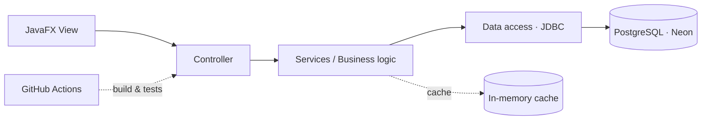
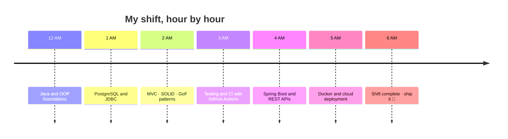

<!-- Profile README for https://github.com/Mateosalazar543 -->

<div align="center">


<a href="https://github.com/Mateosalazar543">
  
</a>

<br/>


<a href="https://github.com/Mateosalazar543?tab=repositories"></a>
<a href="https://github.com/Mateosalazar543?tab=followers"></a>

</div>

---

## 👨‍💻 About me

I'm a **Systems Engineering student** at **Pontificia Universidad Javeriana** (Bogotá 🇨🇴), **powered by artificial intelligence**: I use AI as a copilot to learn faster, build more and ship better, while still understanding the design decisions behind every line. I'm interested in **backend development, software architecture and building reliable applications**.

| | |
|---|---|
| 🏥 **Building** | **CareStock**, a multi-branch pharmacy inventory management system |
| 🎮 **Created** | **VerbQuest**, a game to learn English irregular verbs |
| 🧠 **Learning** | SOLID · MVC · GoF design patterns · transactional data access · testing |
| 🤖 **Powered by** | AI-assisted learning and development: faster iteration, deeper understanding |
| 🎯 **Goal** | Turn complex requirements into code that's maintainable and practical |
| 💬 **Ask me about** | Java, JavaFX, PostgreSQL, design patterns, clean architecture |

> [!TIP]
> I like projects where design decisions matter: consistency, traceability and code that someone else can pick up and understand.

---

## 🛠️ Tech stack

<div align="center">

**Languages**


**Tools & technologies**


</div>

---

## 🚀 Featured projects

<table>
<tr>
<td width="50%" valign="top">

#### 🏥 [CareStock](https://github.com/puj-course/FIS_2630_1204_G1)

Pharmacy inventory management with multi-branch segregation, session-aware operations, inventory traceability and a JavaFX interface.

**Stack:** Java · JavaFX · PostgreSQL · JDBC · Maven

**Engineering:** MVC · GoF patterns · transactions · caching · automated tests

<a href="https://github.com/puj-course/FIS_2630_1204_G1">View project →</a>

</td>
<td width="50%" valign="top">

#### 🎮 [VerbQuest](https://github.com/Mateosalazar543/VerbQuest)

A gamified experience to practice English irregular verbs, with adaptive difficulty and responsive design.

**Stack:** HTML · CSS · JavaScript

**Highlights:** adaptive quizzes · mobile-first UI · interactive learning

<a href="https://github.com/Mateosalazar543/VerbQuest">View project →</a>

</td>
</tr>
</table>

<details>
<summary><b>🏗️ CareStock: architecture at a glance</b> (click to expand)</summary>

<br/>



Layers keep UI, business rules and persistence separate, so each part can be tested and changed on its own.

</details>

---

## 🧩 Engineering principles

| Principle | What it means in practice |
|---|---|
| 🧼 **Clean code** | Readable names, small functions, no surprises |
| 🏛️ **Purposeful architecture** | Patterns used because they solve a problem, not for decoration |
| 🗄️ **Reliable data** | Transactions, constraints and traceable changes |
| 🧪 **Tested** | Automated tests as a safety net for refactoring |
| 🤖 **AI with judgment** | AI speeds me up; I review, understand and own every decision |
| 🎨 **Good UX** | Software people actually enjoy using |

---

## 📊 GitHub stats

<div align="center">

<picture>
  <source media="(prefers-color-scheme: dark)" srcset="https://github-readme-stats.vercel.app/api?username=Mateosalazar543&show_icons=true&theme=tokyonight&hide_border=true&bg_color=0D1117&title_color=8B5CF6&icon_color=8B5CF6&include_all_commits=true" />
  <source media="(prefers-color-scheme: light)" srcset="https://github-readme-stats.vercel.app/api?username=Mateosalazar543&show_icons=true&theme=default&hide_border=true&title_color=6D28D9&icon_color=6D28D9&include_all_commits=true" />
  
</picture>
<picture>
  <source media="(prefers-color-scheme: dark)" srcset="https://github-readme-stats.vercel.app/api/top-langs/?username=Mateosalazar543&layout=compact&theme=tokyonight&hide_border=true&bg_color=0D1117&title_color=8B5CF6" />
  <source media="(prefers-color-scheme: light)" srcset="https://github-readme-stats.vercel.app/api/top-langs/?username=Mateosalazar543&layout=compact&theme=default&hide_border=true&title_color=6D28D9" />
  
</picture>

<br/>

<picture>
  <source media="(prefers-color-scheme: dark)" srcset="https://streak-stats.demolab.com?user=Mateosalazar543&theme=tokyonight&hide_border=true&background=0D1117&ring=8B5CF6&fire=8B5CF6&currStreakLabel=8B5CF6" />
  <source media="(prefers-color-scheme: light)" srcset="https://streak-stats.demolab.com?user=Mateosalazar543&theme=default&hide_border=true&ring=6D28D9&fire=6D28D9" />
  
</picture>

</div>

---

## 🗺️ Roadmap

- [x] Build and ship **VerbQuest**
- [x] Apply MVC, GoF patterns and transactional data access in **CareStock**
- [ ] Complete **CareStock** with CI, automated tests and documentation
- [ ] Learn **Spring Boot** and build a REST API
- [ ] Explore **Docker** and cloud deployment
- [ ] Contribute to open source

---

## 🌙 Night Shift at the Repo

> *Every developer works the night shift sometimes. Here's mine.*

```text
╔════════════════════════════════════════════════════╗
║  🔦 NIGHT SHIFT · 12:00 AM → 6:00 AM               ║
║  🔋 POWER LEFT: ██████████░░ 87%  (☕ + 🤖 powered)  ║
║  📟 STATUS: all systems stable · nothing moved...   ║
║             ...probably.                            ║
╚════════════════════════════════════════════════════╝
```

### 📹 Security cameras

| Camera | Location | Status |
|---|---|---|
| 📹 **CAM 01** | CareStock | 🟢 Online · in active development |
| 📹 **CAM 02** | VerbQuest | 🟢 Online · shipped |
| 📹 **CAM 03** | Spring Boot lab | 🟡 Loading... |
| 📹 **CAM 04** | Docker cellar | 🔴 Offline · coming soon |

### 🚪 Who's moving in the hallway?

The animatronics of software: they only show up when you stop watching. These are my defenses.

| Intruder | Real-life bug | Defense |
|---|---|---|
| 🐻 **Null Pointer Freddy** | `NullPointerException` | Validate inputs, use `Optional`, fail early |
| 🐰 **Off-by-one Bonnie** | Index and boundary errors | Boundary tests |
| 🐔 **Memory-leak Chica** | Unclosed connections and resources | `try-with-resources` |
| 🦊 **Race-condition Foxy** | Concurrency and inconsistent data | Transactions, proper isolation |

### 🕛 Surviving until 6 AM



---

## 📫 Let's connect

<div align="center">

<a href="https://github.com/Mateosalazar543"></a>
<a href="https://www.linkedin.com/in/TU-USUARIO/"></a>
<a href="mailto:TU-CORREO@ejemplo.com"></a>

<br/><br/>

*Thanks for visiting! Survive the night. Ship the code. 🚀*


</div>
