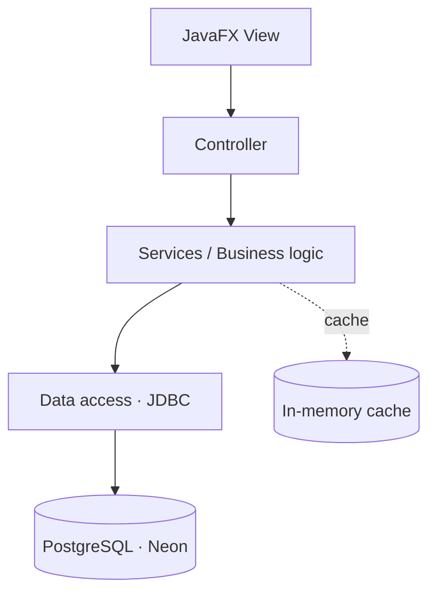

<!-- Profile README for https://github.com/Mateosalazar543 -->

**Systems Engineering Student · Powered by AI · Java Developer**

---

## 👨‍💻 About me

I'm a **Systems Engineering student** at **Pontificia Universidad Javeriana** (Bogotá 🇨🇴), **powered by artificial intelligence**. I use AI as a copilot to learn faster, build more and ship better, while still understanding the design decisions behind every line.

I'm interested in **backend development, software architecture and building reliable applications**.

| | |
|---|---|
| 🏥 **Building** | **CareStock**, a multi-branch pharmacy inventory management system |
| 🎮 **Created** | **VerbQuest**, a game to learn English irregular verbs |
| 🧠 **Learning** | SOLID · MVC · GoF design patterns · transactional data access · testing |
| 🤖 **Powered by** | AI-assisted learning and development |
| 🎯 **Goal** | Turn complex requirements into maintainable, practical code |
| 💬 **Ask me about** | Java, JavaFX, PostgreSQL, design patterns, clean architecture |

> [!TIP]
> I like projects where design decisions matter: consistency, traceability and code that someone else can pick up and understand.

---

## 🛠️ Tech stack

<picture>
  <source media="(prefers-color-scheme: dark)" srcset="https://skillicons.dev/icons?i=java,js,cpp,html,css,postgres,maven,git,githubactions&theme=dark&perline=9" />
  <source media="(prefers-color-scheme: light)" srcset="https://skillicons.dev/icons?i=java,js,cpp,html,css,postgres,maven,git,githubactions&theme=light&perline=9" />
  
</picture>

Java · JavaScript · C++ · HTML · CSS · PostgreSQL · Maven · Git · GitHub Actions

 

---

## 🚀 Featured projects

### 🏥 [CareStock](https://github.com/puj-course/FIS_2630_1204_G1)

Pharmacy inventory management with multi-branch segregation, session-aware operations, inventory traceability and a JavaFX interface.

| | |
|---|---|
| **Stack** | Java · JavaFX · PostgreSQL · JDBC · Maven |
| **Engineering** | MVC · GoF patterns · transactions · caching · automated tests |

<a href="https://github.com/puj-course/FIS_2630_1204_G1">View project →</a>

<b>🏗️ Architecture at a glance</b> (click to expand)

 

Layers keep UI, business rules and persistence separate, so each part can be tested and changed on its own.

### 🎮 [VerbQuest](https://github.com/Mateosalazar543/VerbQuest)

A gamified experience to practice English irregular verbs, with adaptive difficulty and responsive design.

| | |
|---|---|
| **Stack** | HTML · CSS · JavaScript |
| **Highlights** | Adaptive quizzes · mobile-first UI · interactive learning |

<a href="https://github.com/Mateosalazar543/VerbQuest">View project →</a>

---

## 🧩 Engineering principles

| Principle | What it means in practice |
|---|---|
| 🧼 **Clean code** | Readable names, small functions, no surprises |
| 🏛️ **Purposeful architecture** | Patterns used because they solve a problem, not for decoration |
| 🗄️ **Reliable data** | Transactions, constraints and traceable changes |
| 🧪 **Tested** | Automated tests as a safety net for refactoring |
| 🤖 **AI with judgment** | AI speeds me up; I review, understand and own every decision |
| 🎨 **Good UX** | Software people actually enjoy using |

---

## 📊 GitHub stats

<picture>
  <source media="(prefers-color-scheme: dark)" srcset="https://github-readme-stats.vercel.app/api?username=Mateosalazar543&show_icons=true&theme=tokyonight&hide_border=true&bg_color=0D1117&title_color=8B5CF6&icon_color=8B5CF6&include_all_commits=true" />
  <source media="(prefers-color-scheme: light)" srcset="https://github-readme-stats.vercel.app/api?username=Mateosalazar543&show_icons=true&theme=default&hide_border=true&title_color=6D28D9&icon_color=6D28D9&include_all_commits=true" />
  
</picture>
<picture>
  <source media="(prefers-color-scheme: dark)" srcset="https://github-readme-stats.vercel.app/api/top-langs/?username=Mateosalazar543&layout=compact&theme=tokyonight&hide_border=true&bg_color=0D1117&title_color=8B5CF6" />
  <source media="(prefers-color-scheme: light)" srcset="https://github-readme-stats.vercel.app/api/top-langs/?username=Mateosalazar543&layout=compact&theme=default&hide_border=true&title_color=6D28D9" />
  
</picture>

 

<picture>
  <source media="(prefers-color-scheme: dark)" srcset="https://streak-stats.demolab.com?user=Mateosalazar543&theme=tokyonight&hide_border=true&background=0D1117&ring=8B5CF6&fire=8B5CF6&currStreakLabel=8B5CF6" />
  <source media="(prefers-color-scheme: light)" srcset="https://streak-stats.demolab.com?user=Mateosalazar543&theme=default&hide_border=true&ring=6D28D9&fire=6D28D9" />
  
</picture>

---

## 🗺️ Roadmap

| Status | Goal |
|---|---|
| ✅ **Done** | Build and ship **VerbQuest** |
| ✅ **Done** | Apply MVC, GoF patterns and transactional data access in **CareStock** |
| 🔨 **In progress** | Complete **CareStock** with CI, automated tests and documentation |
| 🔜 **Next** | Learn **Spring Boot** and build a REST API |
| 🔜 **Next** | Explore **Docker** and cloud deployment |
| 🔜 **Next** | Contribute to open source |

---

## 📫 Let's connect

<!-- Add your own links when ready, then remove the comment markers:

-->

  

*Thanks for visiting! Keep learning. Keep building. 🚀*

